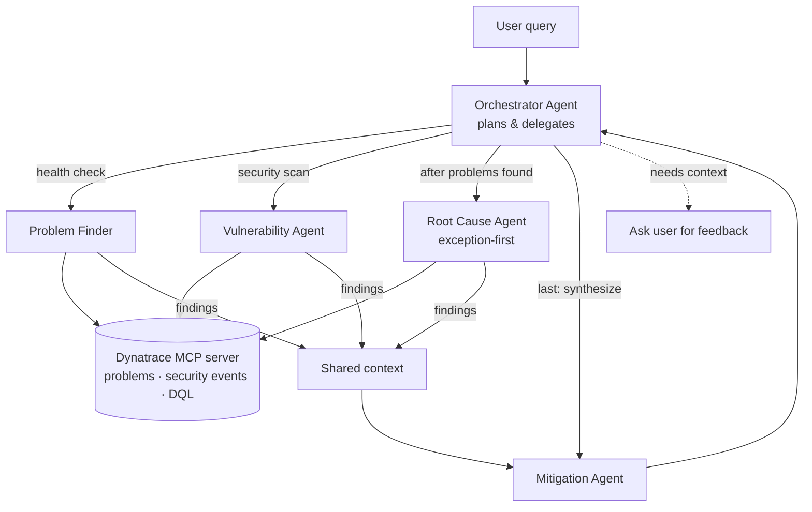

# SRE Multi-Agent for Dynatrace

An LLM-orchestrated team of SRE agents that investigates production incidents and security issues through the [Dynatrace MCP server](https://github.com/dynatrace-oss/dynatrace-mcp). It's built with [Pydantic AI](https://ai.pydantic.dev/).

Ask a question in plain English ("Why is the payment service slow? Fix it"). An **orchestrator agent** decides which specialist agents to call and in what order, then combines their structured findings into one answer.

## 🏗️ Architecture



| Agent | Role | Output |
|---|---|---|
| **Orchestrator** | Understands intent, chooses which agents to call (Problem Finder and Vulnerability can run in parallel; Root Cause after problems are found; Mitigation last) | Summary, findings, recommendations |
| **Problem Finder** | Scans for active `DAVIS_PROBLEM` events and affected services | Problems, services, severity |
| **Vulnerability Agent** | Queries security events for CVEs, risk scores and compliance rules | Vulnerabilities, affected entities, risk score |
| **Root Cause Agent** | Exception-first deep dive: span exceptions → stack traces → correlated logs | Root cause, exception, correlated logs |
| **Mitigation Agent** | Combines all previous findings into a plan | Immediate actions, automation triggers, long-term fixes, prevention |

**Design choices**
- **The LLM does the routing.** There are no hardcoded rules: each specialist agent is exposed to the orchestrator as a tool.
- **Structured outputs.** Every agent returns a Pydantic model (or an explicit `Failed` reason), so the results can be composed safely.
- **Shared context.** Findings from earlier agents are passed to the Mitigation Agent.
- **Prompts live in plain text** in [`instructions/`](instructions/), so they're easy to edit and version.
- **Per-agent model config.** A stronger model orchestrates and cheaper models do the specialist work (see `config.py`).

## 🚀 Quick start

Requirements: Python 3.10+, Node.js (the Dynatrace MCP server runs via `npx`), a Dynatrace environment, and an OpenAI or Anthropic API key.

```bash
pip install -r requirements.txt
cp .env.example .env      # fill in your API key and Dynatrace credentials
python main.py            # run from the repo root
```

Models are set in [`config.py`](config.py). By default `gpt-4o` orchestrates and `gpt-4o-mini` runs the specialists. Any [Pydantic AI model string](https://ai.pydantic.dev/models/) works (e.g. `anthropic:<model-name>`).

## 💬 Example

```
You: Are there any problems in production?
→ Orchestrator calls: Problem Finder

You: Check for security vulnerabilities
→ Orchestrator calls: Vulnerability Agent

You: Why is the payment service slow? Fix it
→ Orchestrator calls: Problem Finder → Root Cause → Mitigation

You: Full security and health audit
→ Orchestrator calls: Problem Finder + Vulnerability → Root Cause → Mitigation
```

## 📁 Project structure

```
├── main.py                    # Interactive chat loop
├── orchestrator.py            # Orchestrator agent + specialist agents as tools
├── agents/                    # Problem Finder, Vulnerability, Root Cause, Mitigation
├── instructions/              # System prompts (one .txt per agent)
├── config.py                  # Models, credentials (from .env), request limit
├── dynatrace_mcp_config.json  # Dynatrace MCP server launch config
├── moderator.py               # Input moderation hook (pass-through for now)
└── memory_updater.py          # Memory hook (pass-through for now)
```

## 🗺️ Roadmap
- Long-term memory across sessions (`memory_updater.py`)
- Input guardrails (`moderator.py`)
- Evaluating agent answers with LLM-as-judge

## ⚠️ Disclaimer
Personal project, not an official Dynatrace product. Mitigation plans are suggestions: the agents investigate but do not run remediation.
